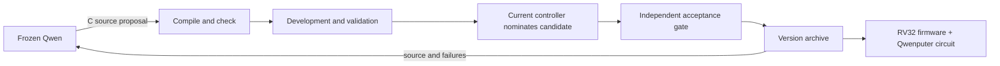

# QwenRSI

**Editable agent controllers, executed as Qwenputer circuits.**

QwenRSI connects a frozen Qwen model to a versioned C harness. Qwen proposes edits
to its task policy and candidate-selection policy. The system compiles each
proposal to native code and RV32 firmware, checks both executions agree, measures
it, and keeps admitted versions. The selected controller can run freely on
Qwenputer's compiled Gated DeltaNet/SwiGLU circuit on a GPU.

This is an experimental implementation of a bounded self-modification loop.
It does not train Qwen, demonstrate unbounded recursive improvement, or claim
that an internal harness is faster than native code.



## Install

Python 3.10+, a native C compiler, and Zig 0.14.1 are required. The Zig Python
wheel supplies a cross compiler; no RISC-V SDK is needed. The CPU/reference
commands work without a GPU or Qwen weights.

```bash
git clone https://github.com/tongmd/QwenRSI.git
cd QwenRSI
python -m venv .venv
source .venv/bin/activate
pip install -e '.[dev]' 'ziglang>=0.14,<0.15'
qwenrsi build examples/baseline.c --out build/baseline
qwenrsi check build/baseline
qwenrsi build examples/verified.c --out build/verified
qwenrsi eval build/verified --backend reference --out build/verified/evaluation.json
```

For GPU execution and local Qwen inference, install `pip install -e '.[gpu]'`.
On Linux, use a CUDA-compatible PyTorch installation. GPU circuit execution also
requires Triton (bundled with the Linux CUDA PyTorch distribution).

## Let Qwen modify its controller

```bash
qwenrsi evolve examples/baseline.c \
  --model Qwen/Qwen3.5-4B --device cuda:0 \
  --iterations 3 --out runs/experiment-001
```

Each iteration saves the actual prompt and model response, proposed C source,
compiled ELF, sampled native/RV32 conformance, development/validation trajectories
and admission decision. `SELECTED` identifies the surviving version. Directories
are never silently reused. The final test split is evaluated after selection and
never enters the proposal context. Repeated validation feedback still permits
validation overfitting; the final test remains a separate check.

`qwenrsi replay runs/experiment-001` independently recomputes all recorded scores
with the RV32 reference and verifies that executable source matches the actual
model responses. This is deterministic replay, not an external research review.

The included **repair-protocol simulator** supplies transient failures and a
second repair after failed verification. Its scores measure protocol correctness,
not general software-engineering ability. The seed controller deliberately omits
verification. `examples/verified.c` is a human-written comparison, not a model
proposal. Compare against it to avoid interpreting recovery from a weak seed as
a new capability.

## Run the controller inside Qwenputer

```bash
qwenrsi audit-circuit build/verified --out build/verified/gpu-audit.json
qwenrsi eval build/verified --backend cuda --count 16 --out build/verified/cuda-eval.json
qwenrsi export build/verified --out artifacts/controller
```

`audit-circuit` generates the full instruction trace from circuit outputs and
compares it with the independent RV32 reference afterwards. It does not feed
reference answers into decoding. Both task-policy and meta-selector entry points
are audited. `export` writes real sparse circuit coefficient tensors to
`controller.safetensors`, bundles the selected firmware and source, then reloads
the tensors and tests them again.

```python
from qwenrsi.circuit import load_bundle

controller = load_bundle("artifacts/controller", device="cuda:0")
action = controller.decide([1, 1, 0, 0, 1, 8, 4])
print(action)  # 2: test (for examples/verified.c)
```

The model bundle is a **compiled controller**, not a trained Qwen language model
or a stock Transformers checkpoint. Frozen Qwen is loaded separately. Program
ROM/RAM/registers are initialized from firmware; the circuit tensors implement
the CPU. A harness edit changes program state, not the language model's weights.

## Real Python repair pilot

```bash
qwenrsi coding-eval build/verified --model Qwen/Qwen3.5-4B \
  --tasks examples/coding_tasks.json --backend cuda --out runs/coding-pilot
```

The compiled controller schedules inspect/patch/test/finish. Qwen writes real
Python repairs. Visible tests provide retry feedback; separate oracle tests judge
the final file. All model calls, generated modules and decisions are recorded.
The four authored tasks are a small integration pilot, not SWE-bench. You can
supply another task JSON using the same schema.

Generated C and Python are executable code. Compilation restrictions and subprocess
timeouts are not a security sandbox. Run untrusted proposals in an isolated
container or disposable account.

## What runs where

| Component | Location |
|---|---|
| Qwen proposal and repair generation | Frozen base model on GPU |
| Task policy and editable version selector | Native/RV32 during search; Qwenputer circuit with CUDA backend |
| RV32 CPU arithmetic and memory recurrence | Compiled Gated DeltaNet/SwiGLU circuit, upstream Triton executor |
| C compiler, benchmark, test subprocesses, admission gate | Host |
| Version archive and model-bundle serialization | Host |

Self-modification is constrained to the two public C functions. The compiler,
evaluation code, data and final admission gate are outside the editable program.
Changing the meta-selector is supported; a textual edit alone is not evidence
that the ability to improve has itself improved.

## Scope and related work

[Qwenputer](https://github.com/divagr18/qwenputer) provides the compiled CPU,
memory construction and executor. [QwenFX](https://github.com/divagr18/QwenFX)
already runs a coding-agent harness on that CPU.
[Meta-Harness](https://github.com/stanford-iris-lab/meta-harness) and the
[Darwin Gödel Machine](https://arxiv.org/abs/2505.22954) study harness search and
self-modifying agents. QwenRSI is an engineering integration with an explicit
editable ABI and evidence trail; this release does not establish a novel RSI
algorithm. Automatic hotspot-to-circuit JIT is future work, not implemented here.

See [architecture](docs/architecture.md), [reproduction](docs/reproduction.md),
[third-party attribution](THIRD_PARTY_NOTICES.md), and [MIT license](LICENSE).
